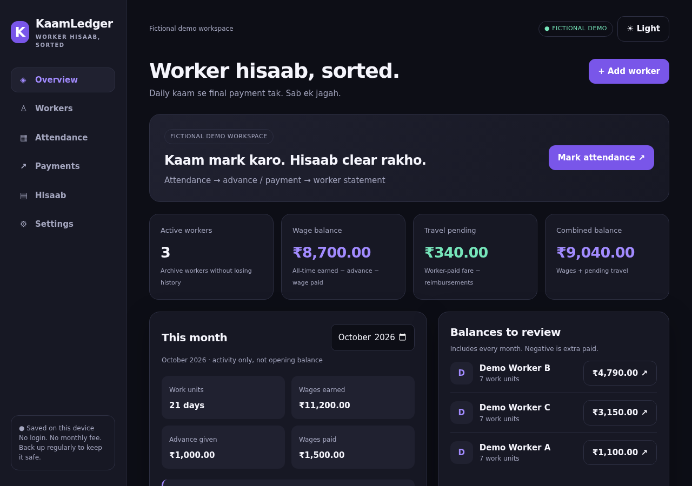
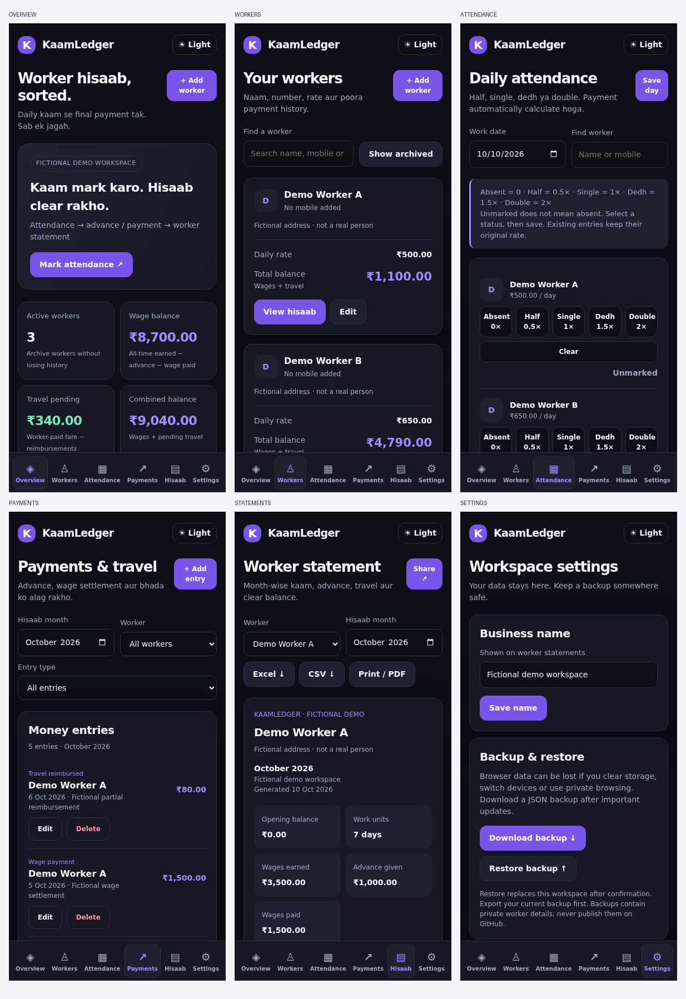
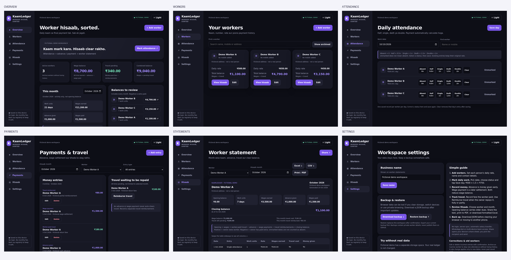

# KaamLedger
### Worker hisaab, sorted.

A simple, phone-first worker ledger for owners and small contractors. Keep daily work, wages, advances and worker-paid travel in one place. No account, paid API, subscription or card needed.

**New workspace starts empty.** Optional fictional demo data lives separately from your real records.

## Start in 2 minutes

1. Open the app, choose **Add worker**, and enter the person's name and daily rate. Mobile and address are optional.
2. Open **Attendance**, select a work date and mark each worker. Tap **Save day**.
3. Open **Payments** to record an advance, wage payment or travel cost.
4. When the owner repays travel, choose **Reimburse travel**. Full and partial repayment are supported.
5. Open **Hisaab**, choose a worker and month, and review the opening and closing balances.
6. Choose **Share**, **Excel**, or **Print / PDF**. Back up your data from **Settings** regularly.

Simple Hinglish labels explain the workflow inside the app.

## Daily wage calculation

| Attendance | Day units | At ₹500 per day |
|---|---:|---:|
| Absent | 0 | ₹0 |
| Half | 0.5 | ₹250 |
| Single | 1 | ₹500 |
| Dedh (one and a half) | 1.5 | ₹750 |
| Double / dubly | 2 | ₹1,000 |

**Unmarked is not absent.** One record is saved per worker per date. You can correct a saved status or clear that day's entry. Changing a worker's rate affects new attendance only; old records retain their saved rate. Currency is stored in integer paise, with computed wages rounded to the nearest paise.

## Money rules: avoid double counting

- **Advance given:** money the owner gave early. Reduces wage balance.
- **Wage payment:** money paid toward earned wages. Also reduces wage balance.
- **Worker-paid travel:** fare the worker paid first. Adds a travel amount owed to the worker.
- **Travel reimbursement:** repayment linked to a travel entry. Reduces pending travel, not wages.

Do not enter the same transfer as both an advance and a wage payment.

```
Wage balance = earned wages - advances - wage payments
Travel balance = worker-paid travel - travel reimbursements
Combined balance = wage balance + travel balance
Monthly closing = opening balance + wages + travel cost
                  - advances - wage payments - travel reimbursements
```

Positive balance means the owner owes the worker. Negative means extra money has already been given, including advance credit. Older balances carry into the next month; they are never silently reset. A month's closing balance includes everything through that month's last day, not later payments. This is a ledger, not proof that a bank transfer happened.

### Example

₹500 daily rate × 1.5 days = ₹750 wages. ₹200 advance and ₹300 wage payment leave ₹250 wages due. Worker paid ₹180 travel; owner repaid ₹80. Travel pending is ₹100. **Combined balance is ₹350.**

## Screens

| Screen | What it does |
|---|---|
| Overview | All-time wage/travel balances, current-month activity and workers to review |
| Workers | Add/edit contacts and rates; search by name/mobile/address; archive inactive workers |
| Attendance | Five day-unit choices, date selector, worker search and explicit save |
| Payments | Add/edit/delete entries; filter by month, worker and type; repay pending travel |
| Hisaab | Monthly statement, opening carry-forward, daily details, separate wage/travel closing balances |
| Settings | Workspace name, private JSON backup/restore, separate demo and usage guide |







## Sharing and exports

- **Share:** uses the device's native share sheet when supported. You choose WhatsApp and the recipient and send yourself. When unavailable, a copyable full statement appears. Nothing is sent automatically; no WhatsApp paid API is used.
- **Excel (.xlsx):** real workbook with daily details and summary, colored headers, frozen first row, header filters, typed dates/numbers and INR amounts. Phone numbers remain text to preserve leading zeros. Open in Excel or a compatible spreadsheet app. A basic phone preview may not expose filters.
- **CSV:** plain activity table, correctly quoted with formula-like strings escaped. Formatting and the opening/closing summary are in Excel, not CSV.
- **Print / PDF:** prints the selected statement; use the browser's Save as PDF option. Output is static, not a live link to the owner's ledger.
- **JSON backup:** complete workspace for restoring on another browser/device. It includes private worker contact details. Do not upload it to this public repository.

## Privacy, storage and limits

This is a single-browser, local-only application. Worker records are stored in `localStorage` under `kaamledger.v1`; the optional demo uses a separate key. No worker details are sent to a backend. The public repo contains only code and clearly fictional examples, not real customer/worker data.

- No login, cloud sync, multi-user access, salary transfer or automatic WhatsApp messages.
- Browser storage is **not encrypted**. Anyone using the same unlocked browser profile can see the ledger.
- Clearing browser/site data, private browsing, a lost phone or browser storage eviction can erase records. Download and securely keep backups after important changes.
- Restore validates the file and asks before replacing the current workspace. Download the current backup first. It replaces rather than merges data.
- Financial edits and deletions are not an immutable audit log. There is no bank reconciliation, tax payroll system or legal payslip claim.
- Travel repayments cannot exceed their linked fare. A fare with repayments cannot be deleted until its repayments are removed. Future-dated entries are not accepted.
- Archived workers retain their history and statements; they are hidden from new attendance.
- There is no service worker or guaranteed offline availability. Once loaded, it needs no network for calculations. Opening `index.html` locally works in a desktop browser, but local-file storage and sharing vary across mobile browsers.

## Development

Plain HTML, CSS and JavaScript. No production dependencies, trackers, external fonts, build step or secrets.

```sh
# Run any static HTTP server in this directory, for example:
python3 -m http.server 8080
# Then open http://localhost:8080
```

`index.html` contains the UI, validation, ledger model, persistence, exports and a small dependency-free XLSX ZIP writer. GitHub Pages serves the root of the `main` branch. `5-source.zip` contains editable app source and documentation.

## QA

Checked the five attendance multipliers, clearing a date, historical-rate preservation, integer-paise arithmetic, advance and wage payment math, partial travel reimbursement, over-repayment rejection, month carry-forward, reload persistence, leading-zero phone preservation, demo isolation and backup restore. Checked all six screens at 320, 390 and 1280 pixels plus light mode. Opened actual XLSX output in LibreOffice and parsed typed cells/filter ranges with openpyxl. Microsoft Excel/mobile Excel itself is not directly tested. A native device WhatsApp share sheet needs the device owner to select the recipient; desktop fallback is checked without sending any message.

Do not store real backup files, private screenshots or credentials in the public repo.
